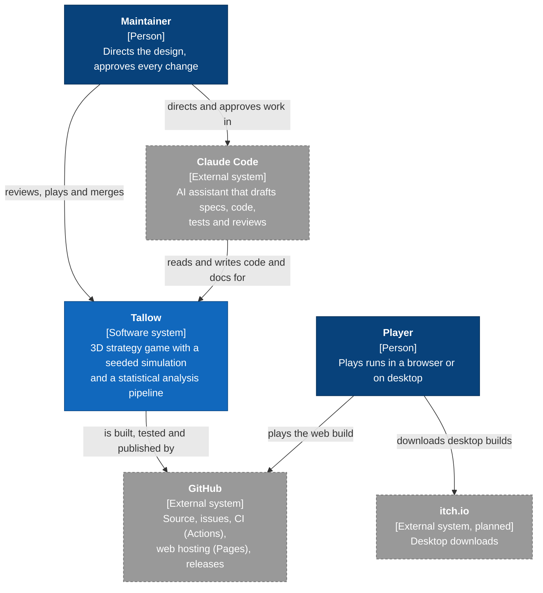
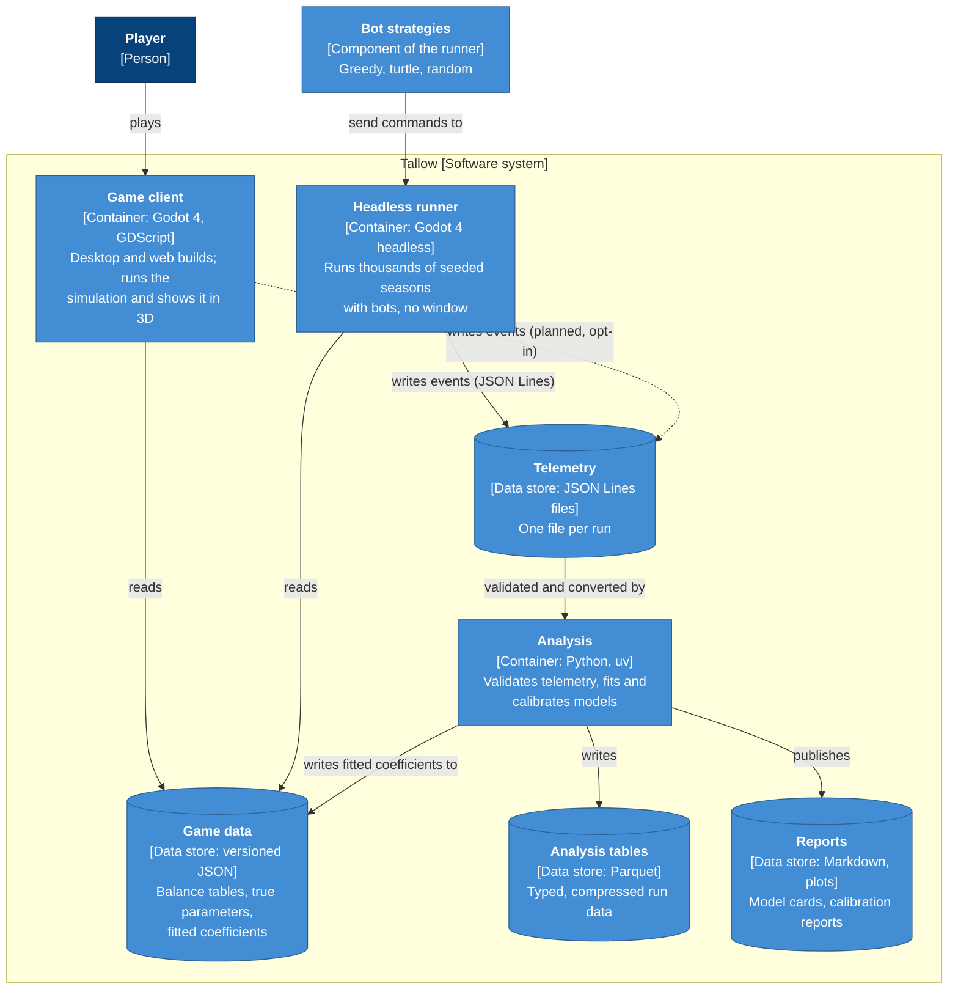
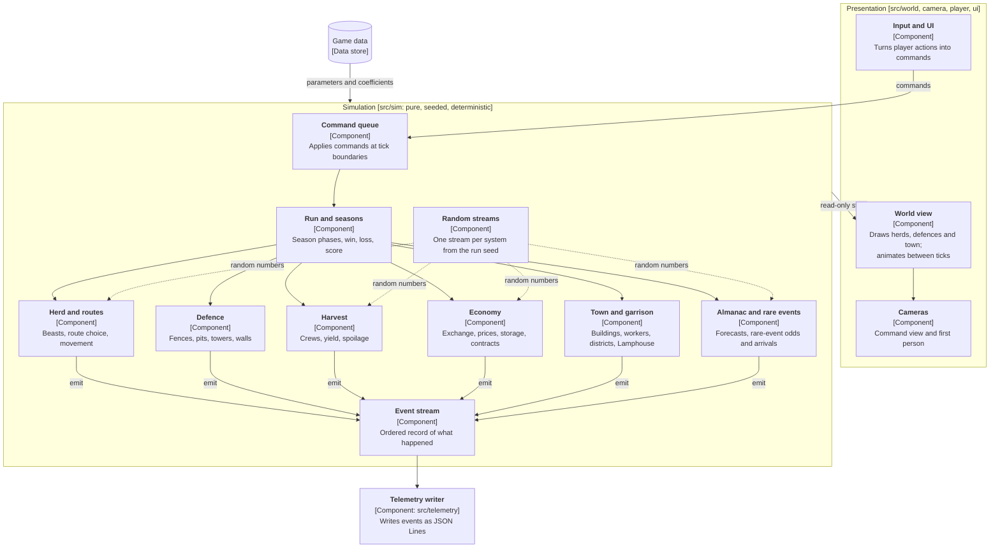
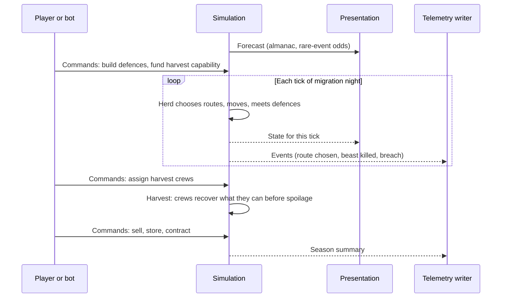
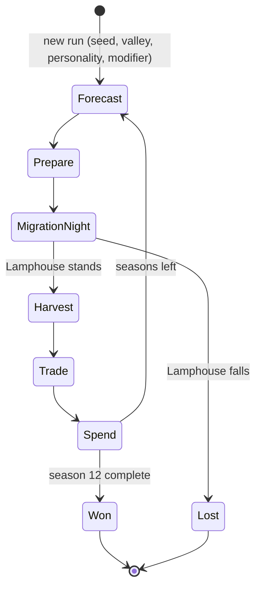
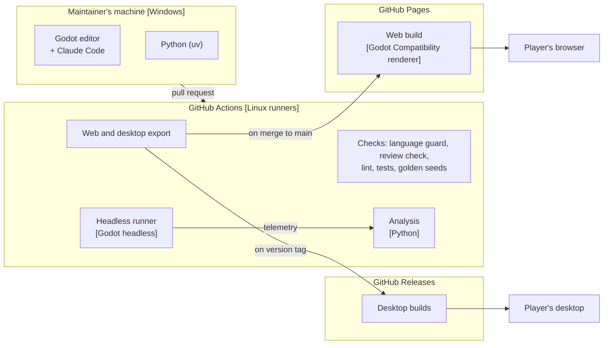
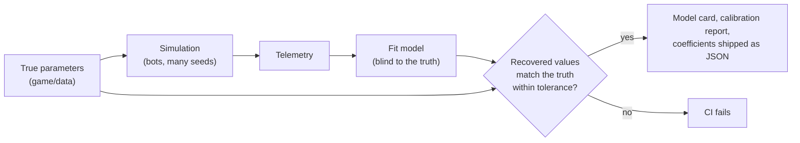

# Architecture overview

> Living document. Updated whenever an ADR or a milestone changes the shape of the system. Components marked *planned* do not exist yet.

Tallow has one authoritative simulation, a 3D presentation that shows it, and a Python analysis layer that learns from it. Fitted models flow back into the game as data, never as code.

This page follows the [C4 model](https://c4model.com/) ([ADR-0004](../adr/0004-architecture-documentation-c4.md)): each level zooms in on the one above.

| View | Question it answers | Section |
|---|---|---|
| Level 1: System context | Who uses Tallow, and what does it depend on? | [1](#1-system-context) |
| Level 2: Containers | What are the separately runnable parts and data stores, and how do they talk? | [2](#2-containers) |
| Level 3: Components | What are the main building blocks inside the game? | [3](#3-components-game-client) |
| Level 4: Code | How is a component implemented? | Not drawn; the code is the source of truth |
| Dynamic | What happens, in what order, during one season? | [4](#4-dynamic-view-one-season) |
| State | What phases does a run move through? | [5](#5-state-view-the-run) |
| Deployment | Where does each container run? | [6](#6-deployment-view) |
| Data flow | How does telemetry become a model the game uses? | [7](#7-the-statistical-loop) |

**Notation used in every diagram.** Each box shows its name, its type in square brackets (person, software system, container, component) with the technology, and a one-line responsibility. Arrows are labelled with what flows and, where it matters, how. Dashed boxes are external to Tallow.

## 1. System context

**Shows:** Tallow as one box, the people who use it and the outside systems it relies on. **Leaves out:** everything inside Tallow.



## 2. Containers

**Shows:** the separately runnable applications and data stores inside Tallow, their technology, and how data moves between them. **Leaves out:** the internals of each container.



The game client and the headless runner share the same simulation code ([ADR-0002](../adr/0002-sim-render-separation.md)). The telemetry format is set by [ADR-0003](../adr/0003-telemetry-format.md).

## 3. Components: game client

**Shows:** the main building blocks inside the game client and the rule that separates them: the simulation side never depends on the presentation side. **Leaves out:** classes and functions. Components are *planned* and will firm up during M1.



**The dependency rule:** arrows into the simulation carry only commands and data. Presentation reads simulation state but never changes it, and nothing in `src/sim/` refers to presentation.

## 4. Dynamic view: one season

**Shows:** the order of interactions during one season. **Leaves out:** the detail of each rule.



## 5. State view: the run

**Shows:** the phases a run moves through and what ends it. **Leaves out:** what happens inside each phase.



## 6. Deployment view

**Shows:** where each container runs and how builds reach players. **Leaves out:** CI job detail.



## 7. The statistical loop

**Shows:** how the project proves its models work. **Leaves out:** the models themselves (see `docs/models/` once they exist).



Because the simulation knows the truth, every model in the repository can be checked against it.

## Layers at a glance

| Layer | Where | Does | Never does |
|---|---|---|---|
| Simulation | `game/src/sim/` | Owns every game rule and all game state. Advances in fixed ticks from commands and a seed. Emits events. | Touch scenes, nodes, rendering, input, files or the wall clock. Use unseeded randomness. |
| Presentation | `game/src/world/`, `camera/`, `player/`, `ui/` | Shows simulation state in 3D, animates between ticks, turns player input into commands. | Change simulation state directly. |
| Headless runner | `game/tools/` | Runs seeded seasons with bots and no window. | Contain rules of its own. |
| Telemetry writer | `game/src/telemetry/` | Turns simulation events into JSON Lines files. | Decide what happens in the game. |
| Data | `game/data/` | Balance tables and fitted coefficients, versioned. | Contain logic. |
| Analysis | `analysis/` | Validates telemetry, fits and calibrates models, writes reports and coefficients. | Re-implement game rules. |

## Folder layout

```text
game/                    Godot 4 project
  src/sim/               simulation: herd, routes, defence, harvest, economy, town, run, events
  src/world/             3D presentation of simulation state
  src/camera/            command view and first person
  src/player/            first-person controller and harpoon
  src/ui/                menus, HUD and theme
  src/telemetry/         telemetry writer
  scenes/                Godot scenes
  assets/                models, textures, audio, fonts (each listed in CREDITS.md)
  data/                  balance tables and fitted coefficients (versioned JSON)
  tools/                 headless runner
  tests/                 gdUnit4: unit/, invariants/, golden/
analysis/                Python, managed with uv
  src/tallow_analysis/   io, features, models, calibration, reports
  tests/
  notebooks/             exploratory only; outputs stripped
  fixtures/              small sample telemetry
telemetry/               local run output (git-ignored)
```

Folders are created as each part lands during M0.

## Keeping this page true

- A PR that adds or removes a container, a component or a dependency between them updates the matching diagram in the same PR. The reviewer checks this.
- Diagrams are Mermaid in Markdown, so they are reviewed and diffed like code.
- If a diagram and the code disagree, the code wins and the diagram is fixed.
