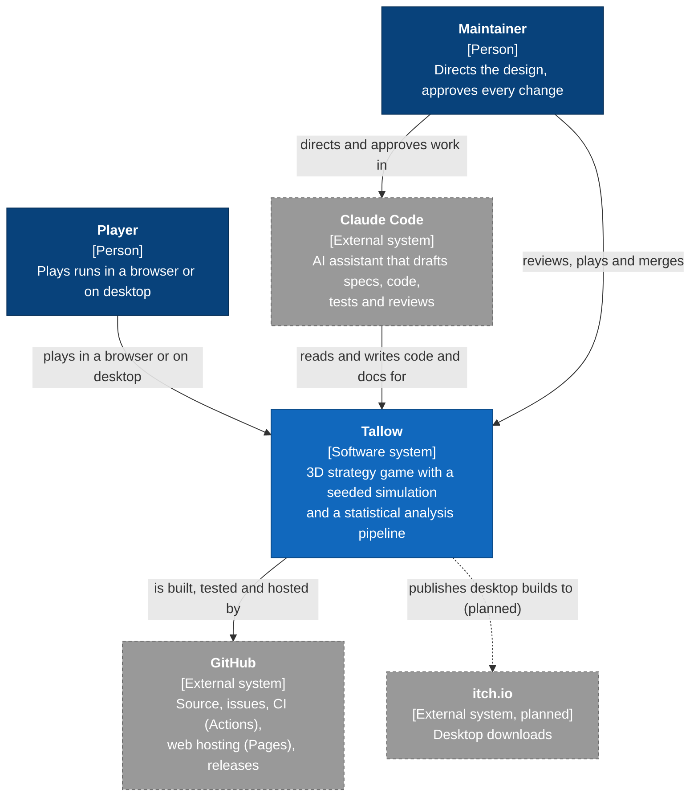
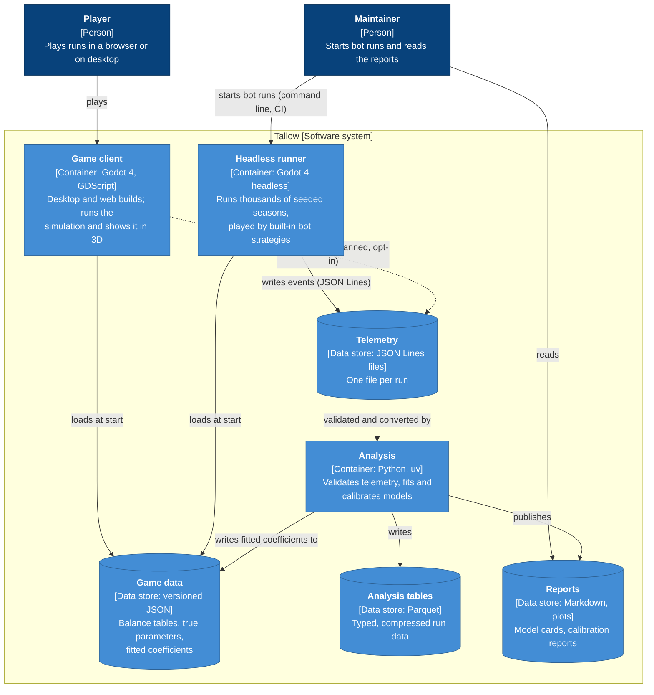
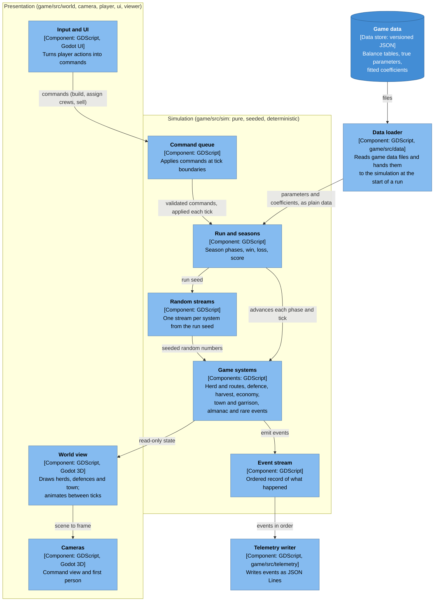
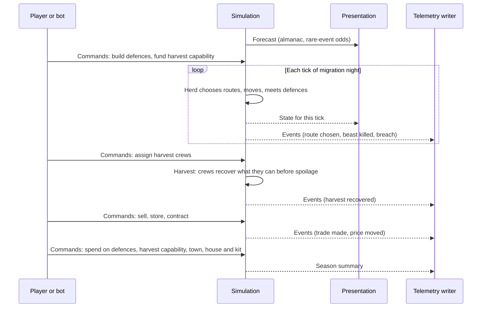
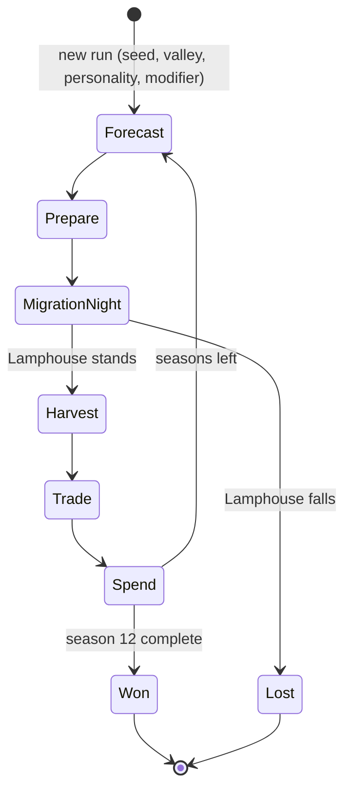
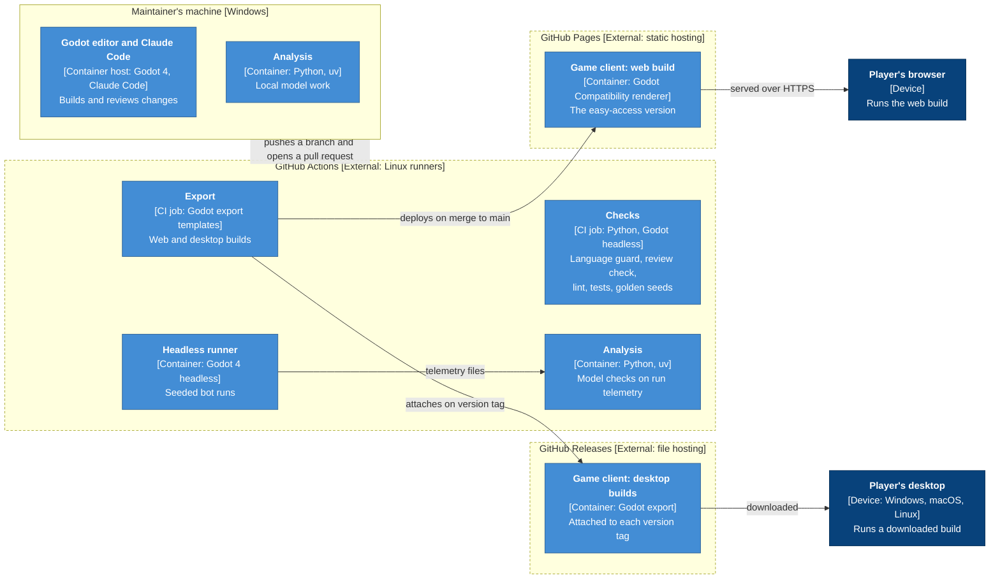
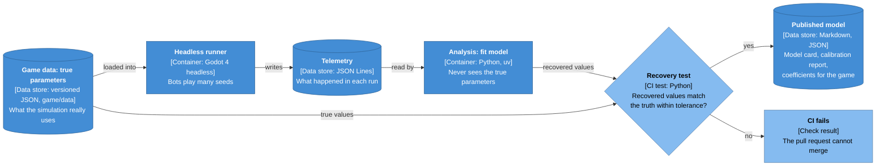

# Architecture overview

> Living document. Updated whenever an ADR or a milestone changes the shape of the system.
>
> **Status: design.** This page describes the target architecture. As of M0 step 6, the Godot project exists with its lint and test setup; the containers and components below are built from step 7 onwards (see the [roadmap](../milestones/roadmap.md)). Elements marked *planned* come after the vertical slice.

Tallow has one authoritative simulation, a 3D presentation that shows it, and a Python analysis layer that learns from it. Fitted models flow back into the game as data, never as code.

This page follows the [C4 model](https://c4model.com/) ([ADR-0004](../adr/0004-architecture-documentation-c4.md)): each level zooms in on the one above.

| View | Question it answers | Section |
|---|---|---|
| Level 1: System context | Who uses Tallow, and what does it depend on? | [1](#1-system-context) |
| Level 2: Containers | What are the separately runnable parts and data stores, and how do they talk? | [2](#2-containers) |
| Level 3: Components | What are the main building blocks inside the game? | [3](#3-components-game-client) |
| Level 4: Code | How is a component implemented? | Not drawn; the code is the source of truth |
| Dynamic | What happens, in what order, during one season? | [4](#4-dynamic-view-one-season) |
| State | What phases does a run move through? | [5](#5-state-view-the-run) |
| Deployment | Where does each container run? | [6](#6-deployment-view) |
| Data flow | How does telemetry become a model the game uses? | [7](#7-the-statistical-loop) |

**Notation used in every diagram.** Each box shows its name, its type in square brackets with the technology, and a one-line responsibility. The C4 types are person, software system, container, component and data store; the deployment and data-flow views also use device, CI job, CI test and check result. Arrows are labelled with what flows and, where it matters, how. Dashed boxes and outlines are external to Tallow; dashed arrows are planned links. The same element keeps the same name in every view.

## 1. System context

**Shows:** Tallow as one box, the people who use it and the outside systems it relies on. **Leaves out:** everything inside Tallow.



## 2. Containers

**Shows:** the separately runnable applications and data stores inside Tallow, their technology, and how data moves between them. **Leaves out:** the internals of each container.



The game client and the headless runner share the same simulation code ([ADR-0002](../adr/0002-sim-render-separation.md)). The telemetry format is set by [ADR-0003](../adr/0003-telemetry-format.md).

## 3. Components: game client

**Shows:** the main building blocks inside the game client and the rule that separates them: the simulation side never depends on the presentation side. **Leaves out:** classes and functions, and the individual game systems' connections to each other. Components firm up during M1.



**The dependency rule:** arrows into the simulation carry only commands and plain data. The simulation never loads files itself: the data loader, outside `game/src/sim/`, reads them and passes the values in. Presentation reads simulation state but never changes it, and nothing in `game/src/sim/` refers to presentation.

## 4. Dynamic view: one season

**Shows:** the order of interactions during one season. **Leaves out:** the detail of each rule.



## 5. State view: the run

**Shows:** the phases a run moves through and what ends it. **Leaves out:** what happens inside each phase.



## 6. Deployment view

**Shows:** where each container runs and how builds reach players. **Leaves out:** CI job detail.



## 7. The statistical loop

**Shows:** how the project proves its models work. **Leaves out:** the models themselves (see `docs/models/` once they exist). Every telemetry record and field is listed in the [telemetry data dictionary](telemetry.md).



Because the simulation knows the truth, every model in the repository can be checked against it.

## Layers at a glance

| Layer | Where | Does | Never does |
|---|---|---|---|
| Simulation | `game/src/sim/` | Owns every game rule and all game state. Advances in fixed ticks from commands and a seed. Emits events. | Touch scenes, nodes, rendering, input, files or the wall clock. Use unseeded randomness. |
| Presentation | `game/src/world/`, `camera/`, `player/`, `ui/`, `viewer/` | Shows simulation state in 3D, animates between ticks, turns player input into commands. | Change simulation state directly. |
| Headless runner | `game/tools/` | Runs seeded seasons with bots and no window. | Contain rules of its own. |
| Data loader | `game/src/data/` | Reads game data files and passes the values to the simulation at the start of a run. | Hold or change game state. |
| Telemetry writer | `game/src/telemetry/` | Turns simulation events into JSON Lines files. | Decide what happens in the game. |
| Data | `game/data/` | Balance tables and fitted coefficients, versioned. | Contain logic. |
| Analysis | `analysis/` | Validates telemetry, fits and calibrates models, writes reports and coefficients. | Re-implement game rules. |

## Folder layout

```text
game/                    Godot 4 project
  src/sim/               simulation: herd, routes, defence, harvest, economy, town, run, events
  src/world/             3D presentation of simulation state
  src/camera/            command view and first person
  src/player/            first-person controller and harpoon
  src/ui/                menus, HUD and theme
  src/viewer/            top-down 2D replay of a season
  src/telemetry/         telemetry writer
  src/data/              data loader: reads game/data/ and passes values to the simulation
  scenes/                Godot scenes
  assets/                models, textures, audio, fonts (each listed in CREDITS.md)
  data/                  balance tables and fitted coefficients (versioned JSON)
  tools/                 headless runner
  tests/                 gdUnit4: unit/, invariants/, golden/, plus support/ helpers and fixtures/
analysis/                Python, managed with uv
  src/tallow_analysis/   telemetry (loading and checks), later features, models, calibration, reports
  tests/
  notebooks/             exploratory only; outputs stripped
  fixtures/              small sample telemetry
telemetry/               local run output (git-ignored)
```

Folders are created as each part lands during M0.

## Keeping this page true

- A PR that adds or removes a container, a component or a dependency between them updates the matching diagram in the same PR. The reviewer checks this.
- Diagrams are Mermaid in Markdown, so they are reviewed and diffed like code.
- If a diagram and the code disagree, the code wins and the diagram is fixed.
